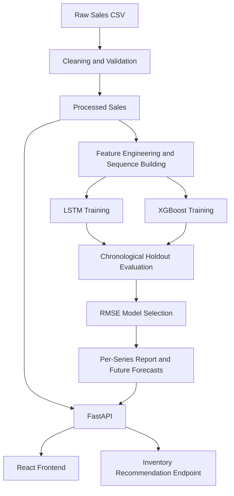

# RetailLens — System Architecture

## 1. System overview

RetailLens forecasts daily demand for store-item series using LSTM and XGBoost. The training pipeline compares the models on a chronological holdout period and records the selected model, metrics, and future forecasts. A read-only FastAPI service exposes historical sales and those saved artifacts.

The frontend is a React/TypeScript application using a light beige and sap-green palette. Its left feature menu slides in as a drawer, and the forecast view supports chart, table, and split layouts.

## 2. Data and training

### Data contract

Sales files use the columns `date`, `store`, `item`, and `sales`. The Kaggle training dataset spans 2013–2017 and contains 500 store-item series. Price, promotion, holiday, and on-hand inventory data are not included.

- `data/raw/train.csv`: source data supplied by the user.
- `data/processed/sales_clean.csv`: cleaned data generated locally.
- `data/processed/models/`: locally generated LSTM/XGBoost models and scalers.
- `data/processed/forecasts/`: locally generated future forecast CSVs.
- `reports/model_comparison_s{store}_i{item}.json`: per-series holdout metrics and selected model.

Data, model binaries, and future forecasts are ignored by Git. When raw data is missing, `src/clean_data.py` generates synthetic sample data for demonstrations. Synthetic-data model results must not be presented as Kaggle results.

### Models

- **LSTM**: sequence model with a training-only fitted scaler and sliding-window inputs.
- **XGBoost**: gradient-boosted trees using calendar features, lags, and rolling statistics.
- **Selection**: `src/models/model_selector.py` chooses the lowest holdout RMSE, then uses MAE to break ties. Selection and performance reporting currently use the same holdout window; a separate final evaluation window or rolling-origin validation is recommended for less biased performance estimates.
- **Forecasts**: `src/train.py` exports 90-day forecasts for both trained models. Each run currently trains one store-item series (default Store 1, Item 1).

## 3. API and inventory recommendations

`api/main.py` provides:

- Health, filtered sales summaries, and paginated historical sales.
- Saved future forecasts, excluding holdout-prediction files.
- Current per-series training reports alongside legacy evaluation artifacts.
- `/inventory/recommendation`, which takes a store-item pair and current stock from the caller, then uses the selected saved forecast.

Inventory calculation in `src/inventory.py` estimates:

- Lead-time demand from the first `lead_time_days` forecast values.
- Safety stock from forecast variability as a proxy.
- Reorder point as lead-time demand plus safety stock.
- Suggested quantity as stock needed to reach reorder point plus one cycle of demand.

The inventory endpoint is a calculation, not a connection to an inventory system. Confirm current stock, demand variability, lead time, and service levels against operational data before using its recommendations for purchasing.

The API is read-only and does not train models or write project files. Set `RETAILLENS_CORS_ORIGINS` to a comma-separated origin list when the frontend is hosted on a non-default origin.

## 4. Local workflow

1. Provide Kaggle `train.csv` at `data/raw/train.csv`.
2. Install `requirements.txt` and run `python src/train.py --store 1 --item 1`.
3. Start the API with `python -m uvicorn api.main:app --reload`.
4. Open <http://127.0.0.1:8000/docs> to inspect and call the endpoints.
5. Start the frontend from the `frontend/` directory with `npm run dev`.

For an API-only environment, install `api/requirements.txt`.

## 5. Technology stack

| Layer | Technologies |
|---|---|
| Core language | Python 3.10+ |
| Data processing | pandas, NumPy |
| Deep learning | TensorFlow/Keras |
| Machine learning | XGBoost, scikit-learn, joblib |
| API | FastAPI, Uvicorn |
| Frontend | React, TypeScript, Vite, Recharts |
| Testing | pytest |
